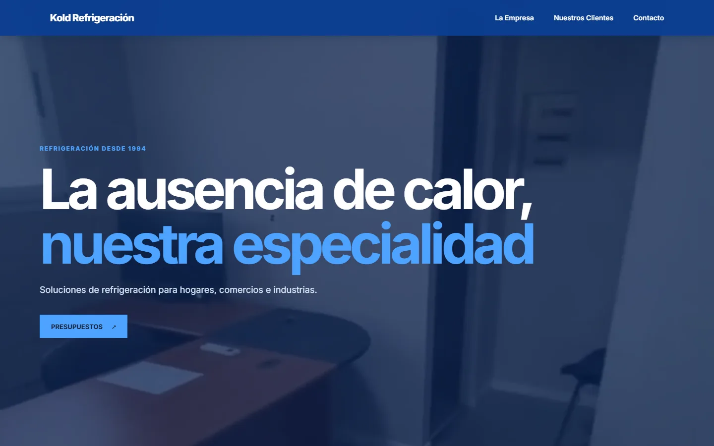
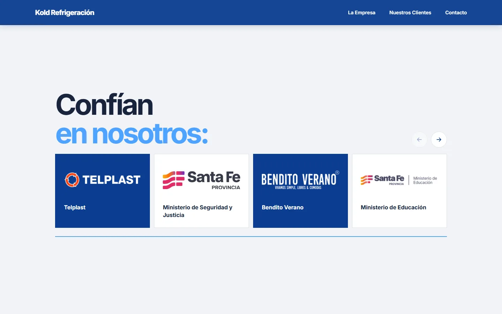
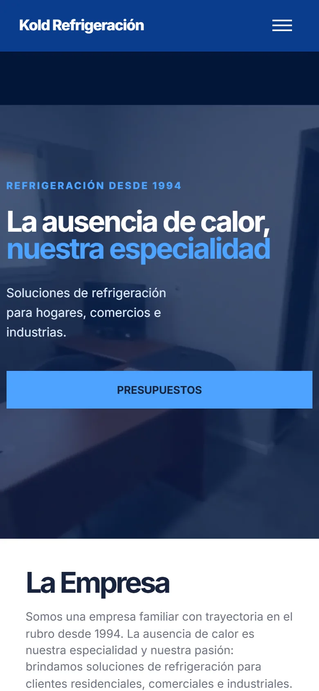

# Kold Refrigeración

Sitio web de una empresa familiar de refrigeración de Santa Fe, Argentina, que trabaja desde 1994 con clientes residenciales, comerciales e industriales. Es una landing de una sola página pensada para que quien necesita un equipo o un service entienda rápido qué hace la empresa, vea con quién trabajó y pida un presupuesto por WhatsApp o por mail.

**🔗 En vivo: [koldrefrigeracion.com.ar](https://koldrefrigeracion.com.ar)**

<p align="center">
  
</p>

<p align="center">
  
  &nbsp;
  
</p>

## Qué resuelve

Quien busca una empresa de refrigeración quiere saber tres cosas antes de llamar:

- **¿Trabajan con lo que necesito?** El inicio dice qué hace la empresa en una frase, y la sección La Empresa separa los tres tipos de cliente: residencial, comercial e industrial.
- **¿Puedo confiar?** Más de 30 años en el rubro y un carrusel con clientes reales, entre ellos organismos públicos, colegios y comercios de la ciudad.
- **¿Cómo pido un presupuesto?** El botón principal lleva directo a contacto, donde están WhatsApp, mail, Instagram, un formulario y un enlace para dejar una reseña en Google.

## Funcionalidades

- **Video de fondo que no frena la carga:** el video del inicio no se descarga con la página. Mientras tanto se ve una imagen fija, y el video se pide recién cuando el inicio está a la vista (`IntersectionObserver`), en una versión más liviana en celulares. Si la persona tiene activado `prefers-reduced-motion`, no se descarga nunca.
- **Formulario que confirma el envío real:** el mail se manda con [FormSubmit](https://formsubmit.co), sin servidor propio. Como FormSubmit puede responder `200` sin haber enviado nada, el script lee el campo `success` de la respuesta y solo muestra el agradecimiento si el mail salió; si no, sugiere escribir por email o WhatsApp.
- **Protección contra spam sin captcha:** un campo trampa oculto descarta los envíos automáticos sin pedirle nada a la persona.
- **Carrusel de clientes con scroll nativo:** usa `scroll-snap` del navegador, así funciona con el dedo, el trackpad y el teclado. Los botones avanzan de a una tarjeta y se desactivan al llegar a cada extremo.
- **Menú móvil:** se abre con el botón y se cierra al elegir una sección, al tocar fuera o con `Escape`, actualizando `aria-expanded`.

## Detalles técnicos

| | |
|---|---|
| **Stack** | HTML, CSS y JavaScript sin frameworks, sin dependencias y sin paso de build |
| **Peso** | ~360 KB para ver la página completa; el video de fondo (6 a 8 MB) se descarga aparte, sin bloquear la carga |
| **SEO** | Datos estructurados `schema.org/HVACBusiness` para búsquedas locales, Open Graph para la vista previa en WhatsApp y redes, URL canónica, `robots.txt` y `sitemap.xml` |
| **Accesibilidad** | Textos alternativos, menú y carrusel con atributos ARIA, mensajes del formulario en una región `aria-live` y respeto de `prefers-reduced-motion` |
| **Hosting** | GitHub Pages con deploy automático por GitHub Actions y dominio `.com.ar` propio |

Algunas decisiones:

- **Sin framework.** Es una sola página con contenido fijo; React o un generador de sitios agregarían peso y mantenimiento sin aportar nada. El JavaScript completo tiene 100 líneas.
- **WhatsApp primero.** Es el canal que más usan los clientes para pedir un presupuesto, por eso aparece destacado arriba del formulario. El mail queda para quien prefiere escribir con más detalle.
- **Videos en Git LFS.** Los dos videos del inicio pesan varios MB; con LFS el repositorio se mantiene liviano y el workflow de deploy los descarga al publicar.

## Estructura

```
├── index.html            Página única: inicio, la empresa, clientes y contacto
├── styles.css            Estilos, con variables de color y tipografía en :root
├── script.js             Video de fondo, menú, formulario y carrusel
├── assets/
│   ├── hero/             Video de fondo (escritorio y celular) e imagen fija
│   └── clients/          Logos de clientes
├── docs/                 Capturas para este README
├── .github/workflows/    Deploy a GitHub Pages
└── CNAME                 Dominio propio para GitHub Pages
```

## Correr localmente

No requiere instalación. Se puede abrir `index.html` directamente en el navegador o levantar un servidor estático:

```bash
npx serve .
```

Para clonar con los videos hace falta tener [Git LFS](https://git-lfs.com) instalado.

## Autoría

Diseño y desarrollo: **[Quantum Dev](https://www.instagram.com/developerquantum/)**.

El nombre, el logo, las fotos, los videos y los textos pertenecen a Kold Refrigeración y no pueden reutilizarse. Los logos de clientes pertenecen a sus respectivos dueños. El código está publicado como muestra de trabajo.
